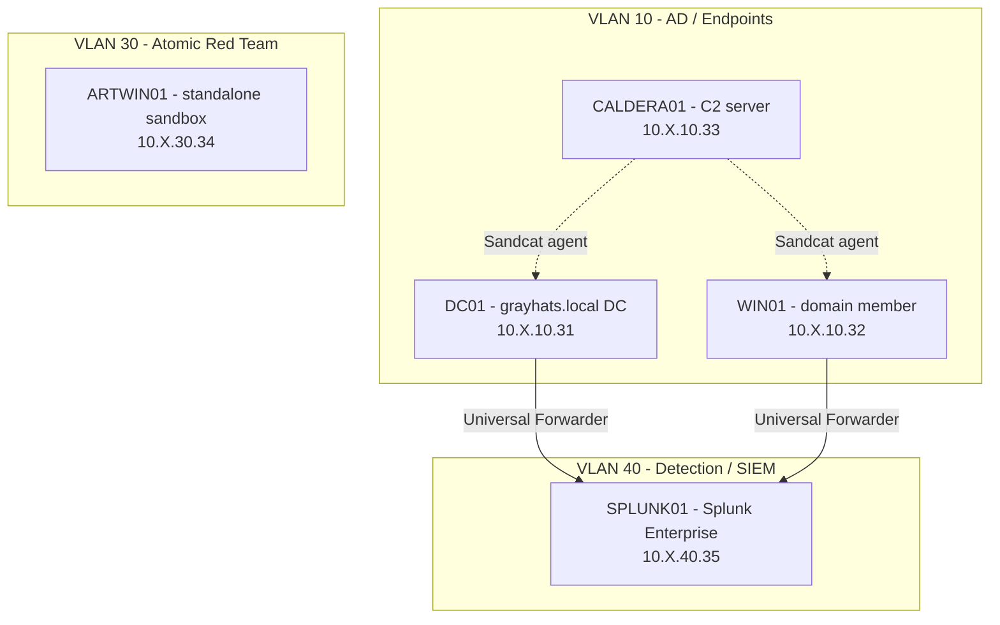

# Splunk Detection Range

Purple-team Ludus blueprint: Caldera red team operations against a small
`grayhats.local` Active Directory environment, defended and detected with
Splunk, plus a standalone Atomic Red Team Windows 11 sandbox to author and
validate atomics before running them for real.

## Quick Start

```bash
ludus source add https://github.com/jessefmoore/splunk-detection-range --all
ludus blueprint apply <sourceID>/splunk-detection-range
ludus range deploy
```
`<sourceID>` comes from the `SOURCE ID` column of `ludus source list` after
the first command — it isn't predictable up front.

No other sources needed — `win2025-server-x64-tpm-template` and
`ubuntu-24.04-x64-server-template` are vendored in this repo's
[`templates/`](../../templates/) (originally from
[`badsectorlabs/ludus-source-bsl`](https://github.com/badsectorlabs/ludus-source-bsl),
see `templates/README.md` for provenance/license); `win11-22h2-x64-enterprise-template`
and `debian-13-x64-server-template` ship with every Ludus install. Run
`ludus templates build` before `range deploy` if any aren't built yet.

## Network Diagram



> Replace `X` with your range's second octet (`ludus range list`).

## VM Details

| VM Name | Hostname | Template | IP | Role |
|---|---|---|---|---|
| `{{ range_id }}-dc01` | dc01 | win2025-server-x64-tpm-template | 10.X.10.31 | primary-dc, Splunk UF, Caldera agent |
| `{{ range_id }}-win01` | win01 | win11-22h2-x64-enterprise-template | 10.X.10.32 | member, Splunk UF, Caldera agent |
| `{{ range_id }}-caldera01` | caldera01 | ubuntu-24.04-x64-server-template | 10.X.10.33 | Caldera C2 server |
| `{{ range_id }}-artwin01` | artwin01 | win11-22h2-x64-enterprise-template | 10.X.30.34 | standalone Atomic Red Team sandbox |
| `{{ range_id }}-splunk01` | splunk01 | ubuntu-24.04-x64-server-template | 10.X.40.35 | Splunk Enterprise |

## Credentials

Full sheet: [`docs/CREDENTIALS.md`](../../docs/CREDENTIALS.md) in the repo
root. All defaults are overridable in `range-config.yml` under `defaults:`
and `global_role_vars:` before deploying.

| Account | Username | Password | Scope |
|---|---|---|---|
| Domain Admin | `Administrator` | `GrayHats-DSAdmin-2026!` | `grayhats.local` |
| Caldera admin | `admin` | `GrayHats-DSCalderaAdmin-2026!` | Caldera web UI, port 8888 |
| Splunk admin | `admin` | `GrayHats-DSSplunk-2026!` | Splunk web UI, port 8000 |

## Attack Paths

Caldera (`caldera01`) runs Sandcat agents against `dc01`/`win01` to generate
offensive telemetry; Splunk Universal Forwarders on both Windows hosts ship
Sysmon/Windows event logs to `splunk01` for detection engineering. The
standalone `artwin01` sandbox lets you author/validate Atomic Red Team tests
in isolation before running them against the live AD hosts.

## Acknowledgments

- [Bad Sector Labs](https://twitter.com/badsectorlabs) for Ludus and the
  `win2025-server-x64-tpm-template` / `ubuntu-24.04-x64-server-template`
  Packer templates (vendored in `templates/`) this blueprint builds on.
